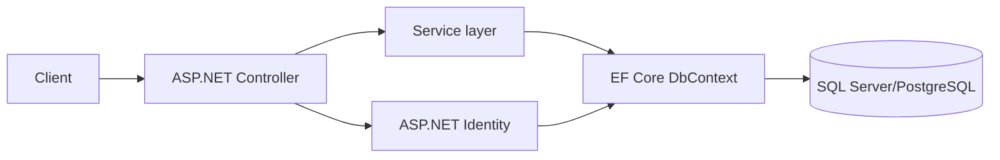

# EFBoilerplate

A `dotnet new` template for **ASP.NET Core MVC + Entity Framework Core (.NET 10)**.
It comes with full CRUD and is already connected to SQL Server running in Docker.

## Architecture / How it Works




## Requirements

- [.NET 10 SDK](https://dotnet.microsoft.com/download)
- SQL Server from [docker-sqlserver](https://github.com/ALPHAMAN-0/docker-sqlserver). It creates the `section_b` database with the `products`, `students` and `employees` tables.

## Install the template (once)

```sh
git clone https://github.com/ALPHAMAN-0/EFBoilerplate.git
dotnet new install ./EFBoilerplate
```

To remove it later: `dotnet new uninstall ./EFBoilerplate`

## Set your database password (once)

`appsettings.json` only has a placeholder. Put your real SA password (the one in docker-sqlserver's `.env`) into
`EFBoilerplate/EFBoilerplate/appsettings.Development.json`:

```json
{
  "ConnectionStrings": {
    "DefaultConnection": "Server=localhost,1433;Database=section_b;User Id=sa;Password=YOUR_SA_PASSWORD;TrustServerCertificate=True"
  }
}
```

That file is gitignored. The template copies it into every project you create, and `dotnet run` uses it in Development,
so your password works everywhere without ever being committed.

## Create a project

```sh
dotnet new efmvc -n Lab5      # makes ./Lab5 with every name and namespace renamed to Lab5
cd Lab5/Lab5
dotnet run                    # open http://localhost:5173/product
```

## What's inside

| File | What it does |
|------|--------------|
| `appsettings.json` | Connection string (`Database=section_b`) |
| `Program.cs` | Registers `AppDbContext` with SQL Server |
| `EF/AppDbContext.cs` | One `DbSet` per table: `product`, `student`, `employee` |
| `Models/*.cs` | One class per table; `[Table("...")]` is the table name |
| `Controllers/ProductController.cs` | Full CRUD example |
| `Views/Product/*.cshtml` | Index, Details, Create, Edit, Delete pages |

| URL | Action |
|-----|--------|
| `GET /product` | List all products |
| `GET /product/details/5` | Show one product |
| `GET /product/create` → `POST /product/create` | Add a product |
| `GET /product/edit/5` → `POST /product/update/5` | Change a product |
| `GET /product/delete/5` → `POST /product/delete/5` | Ask "are you sure?", then delete |

Forms show validation errors and are protected with anti-forgery tokens.

## Add CRUD for another table (example: students)

The `students` and `employees` tables, models and `DbSet`s are already set up. For students:

1. Copy `Controllers/ProductController.cs` to `StudentController.cs`.
   Replace `Product` → `Student` and `product` → `student`, and change the fields in `Update`.
2. Copy the `Views/Product` folder to `Views/Student` and change the fields to `name`, `dept`, `cgpa`.
3. Add a `Student` link in `Views/Shared/_Layout.cshtml`.

For a brand-new table:
- Add a `CREATE TABLE` script to `docker-sqlserver/scripts/` and run `docker compose up -d`.
- Add a model in `Models/`.
- Add a `DbSet` in `EF/AppDbContext.cs`.
- Then do steps 1–3 above.
